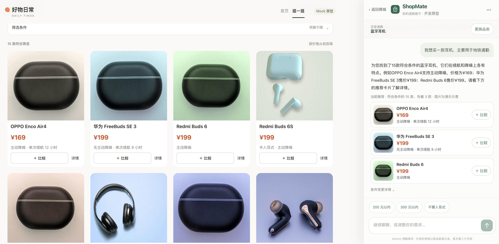

# ShopMate — AI 购物决策助手

**AI Agent MVP 原型｜自然语言选购｜商城协作｜商品证据问答**



*实际运行界面：左侧为模拟商城，右侧为 AI 助手与推荐卡片。商品图片及价格用于演示。*

## 项目概述

用户选购商品时，往往能够说出预算和使用场景，却不容易判断哪些参数重要、不同商品有什么区别。传统筛选页适合执行明确条件，AI 问答则可能遗漏使用限制或误读宣传数据。

**ShopMate** 将对话助手嵌入模拟商城，支持用户用自然语言表达购买需求、筛选与比较候选商品，并在需要时查询官方资料，解释商品功能与参数。首期以 **15 款蓝牙耳机**构建可运行原型，不涉及真实交易。

## 产品体验

以「**想买 300 元以内的蓝牙耳机，主要用于通勤**」为例，用户可以：

1. **提出需求：** 在聊天框输入预算和用途，查看助手识别的购物条件。
2. **浏览候选：** 按已生效的条件筛选商品，查看价格、基础参数和推荐卡片。
3. **比较商品：** 从商城或助手中选择两款商品，并排查看已收录参数。
4. **查证疑问：** 对兼容性、功能限制、降噪指标等问题追问，查看带官网来源的解释。
5. **自主同步：** 确认后将助手中的可同步筛选条件应用到商城页面。

这里的「使用场景」并不自动等于硬性筛选条件。例如仅输入「地铁通勤」，不代表系统已经能稳定推导出「必须主动降噪」。

## 关键产品设计

| 设计重点 | 方案及考虑 |
| --- | --- |
| **自然语言与规则筛选结合** | 模型负责理解需求、选择工具；已确认的预算上限等条件由后端规则执行，商品价格与结构化参数从数据中读取，减少随意生成商品信息的风险。 |
| **助手嵌入商城，而非替代商城** | 用户既能正常浏览、筛选和比较，也能在对话中调整条件；助手与商城的筛选状态通过用户确认进行同步，避免对话直接改动正在浏览的列表。 |
| **商品参数与证据解释分工** | 已收录规格直接通过商品工具查询；遇到编码兼容、测试口径等问题，再按具体型号检索官网资料并展示来源。证据用于解释，不直接决定推荐排序。 |

**实现方式：** Next.js + FastAPI + Gemini 函数调用；RAG 采用官网 HTML 结构化切分、Gemini Embedding 与 FAISS，并支持按商品组织检索结果。

## 从问题发现到迭代验证

原始版本曾把某耳机的「**27dB 平均降噪深度**」误解释为「最大值」。为降低这类事实错误，项目建立固定测试用例，并比较三种证据检索方案：普通切分、DOM 结构化切分，以及加入 BM25 + RRF 的混合检索。

实验中，结构化切分显著改善了证据召回，而混合检索没有体现相应的回答收益，因此选择较简洁的结构化向量检索，并进一步调整规格分组与跨商品证据组织。

| 验证结果 | 改进前 | 改进后 |
| --- | ---: | ---: |
| **Recall@5**（17 道固定检索查询） | 0.588 | **0.912** |
| **降噪参数解释用例得分** | 2/6 | **5/6** |

这一轮完成了**发现问题 → 对照选型 → 产品集成 → 回归验证**的迭代。当前原型已支持基本选购操作和有来源的商品问答，但复杂多商品购买建议仍不稳定；以上为小规模固定用例结果，不等同于用户体验或交易效果已得到验证。

## 本地体验

需要 Python 3.11+、Node.js 22.18+ 及 Gemini API Key。

**终端 1：后端（项目根目录）**

```bash
python3 -m venv .venv
.venv/bin/pip install -r requirements.txt -r requirements-rag.txt
cp .env.example .env   # 在 .env 中填写 GEMINI_API_KEY
.venv/bin/python -m uvicorn app:app --reload --port 8000
```

**终端 2：前端**

```bash
cd frontend
npm ci
npm run dev
```

访问 **http://localhost:3000**。商品浏览和结构化比较不依赖 Gemini；证据检索所需的官网原始资料未随仓库公开。启用 RAG 前，需按照 [`sources_manifest.json`](data/rag/sources_manifest.json) 准备本地资料，再运行 `.venv/bin/python -m src.evidence --build` 建立向量缓存。

## 更多项目资料

- [PRD V0.9（修订草案）](docs/ShopMate_PRD_V0.9.md)：产品目标、功能范围与交互流程
- [竞品分析](docs/ShopMate_竞品分析报告_V1.0.md)：场景研究及设计依据
- [产品质量评测与迭代总结](docs/ShopMate_产品质量评测与迭代总结.md)：测试结果与改进过程
